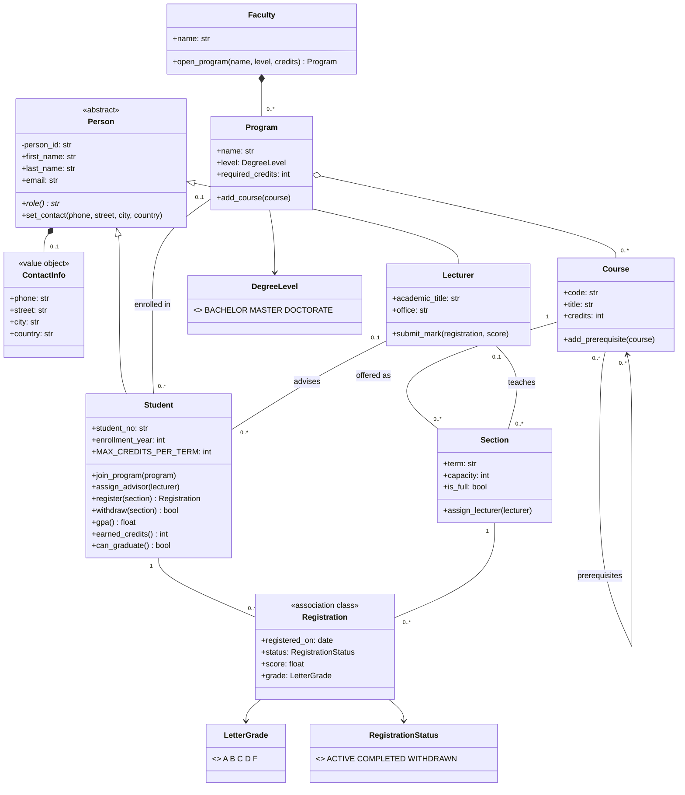

# University Student System - Class Diagram to Python

Maps a UML class diagram of a student registration system to Python 3.9+ code.

## 1. Class diagram



## 2. Mapping rules (design -> code)

| UML element | Python mapping | Where |
|---|---|---|
| Class | `class` | all modules |
| Abstract class / operation | `ABC` + `@abstractmethod` | `Person`, `Person.role()` |
| Generalization | inheritance | `Student(Person)`, `Lecturer(Person)` |
| Enumeration | `enum.Enum` | `LetterGrade`, `RegistrationStatus`, `DegreeLevel` |
| Private attribute (`-`) | `_name` + read-only `@property` | `Person.person_id`, `Registration.score` |
| Static / constant | class attribute | `Student.MAX_CREDITS_PER_TERM` |
| Value object | frozen `@dataclass` | `ContactInfo` |
| Composition | owner creates the part | `Person.set_contact`, `Faculty.open_program` |
| Aggregation | whole stores references passed in | `Program.add_course` |
| Association 0..1 / 1 | single reference attribute | `Student.program`, `Section.lecturer` |
| Association 0..* | `list` exposed as a copy | `Program.students`, `Lecturer.sections` |
| Bidirectional association | one method updates both ends | `Student.join_program`, `Section.assign_lecturer` |
| Self-association | list of the same type | `Course.prerequisites` |
| Association class | separate class holding both ends + link data | `Registration` |
| Business rules | custom exception | `RegistrationError` |

## 3. Business rules implemented
- no duplicate registration, and no re-taking a course already passed
- prerequisites must be passed
- section capacity and a 24-credit limit per term
- only the section's lecturer can submit marks (0-100 -> letter grade)
- GPA = sum(points x credits) / sum(credits); graduation needs the credits and all program courses

## 4. Structure
```
university-student-system/
├── main.py                 # demo
├── university/
│   ├── people.py           # Person, Student, Lecturer, ContactInfo
│   ├── academics.py        # Faculty, Program, Course, Section
│   └── registration.py     # Registration, grades, status, errors
└── tests/test_university.py
```

## 5. Run
```
python main.py
python -m unittest discover -s tests
```
